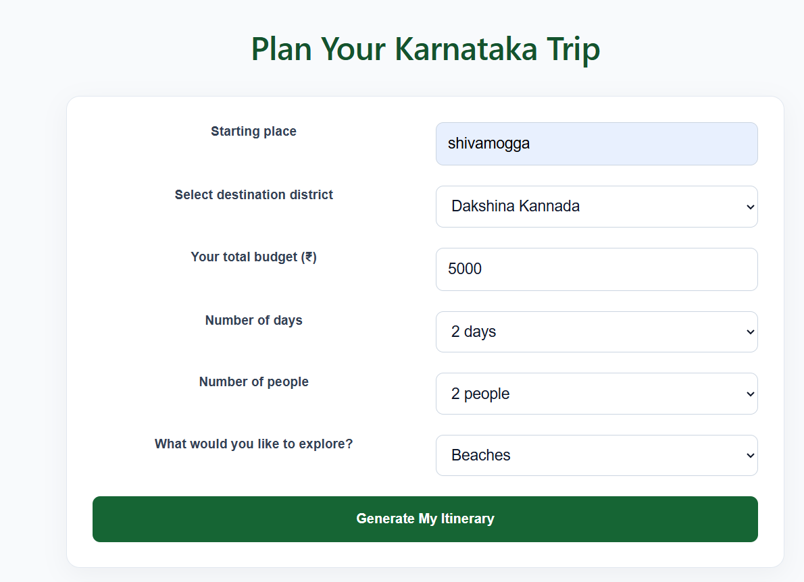

## 🎯 Problem Statement

**Problem Statement 06: AI Travel Planner for Karnataka**

An AI-powered application that helps travellers discover tourist destinations and hidden gems across Karnataka, plan day-by-day trips, and estimate travel expenses.

## ✨ Features

- **31 Karnataka districts:** Choose a district to explore destinations.
- **Tourist place discovery:** Find popular attractions based on your selected district and interests.
- **Hidden gems:** Discover lesser-known places worth exploring.
- **Day-by-day itinerary:** Generate a travel plan for your selected trip duration.
- **Travel expense estimation:** View estimated transportation, food, accommodation, entry fees, and other expenses.
- **Flexible trip planning:** Select your starting place, budget, number of days, and number of travellers.
- **Multiple interests:** Explore nature, temples, history, adventure, beaches, wildlife, and more.
- **Language selection:** Switch between English and Kannada.

## 🛠️ Technologies Used

- React
- Vite
- JavaScript
- Node.js
- Express.js
- Groq API

## 🚀 Getting Started

### Prerequisites

Install Node.js and npm on your computer.

### 1. Clone the repository

```bash
git clone https://github.com/kavithask448-beep/Karnataka-AI-Travel-Planner.git
cd Karnataka-AI-Travel-Planner
```

### 2. Install dependencies

```bash
npm install
```

Install the backend dependencies too if your `package.json` does not already include them:

```bash
npm install express cors dotenv groq-sdk
```

### 3. Configure the API key

Create a `.env` file in the project root and add your own Groq API key:

```env
GROQ_API_KEY=your_groq_api_key_here
```

Replace the placeholder with your own key. Never commit or share your real `.env` file.

### 4. Start the backend

```bash
node server.cjs
```

### 5. Start the frontend

Open a second terminal in the project folder and run:

```bash
npm run dev
```

Open the local URL printed by Vite in your browser.

## 💰 Expense Estimates

The application provides estimated travel expenses to help users plan their budgets. Actual costs may vary depending on the destination, season, transport, accommodation, and personal preferences.

## 🎯 Project Objective

To make travel planning across Karnataka easier by helping travellers discover destinations, explore hidden places, organize itineraries, and estimate trip costs in one application.

## 🔐 Security

API keys and environment files must remain private. Configure environment variables locally and never publish real API keys in source code or public repositories.

## 👩‍💻 Developer

**Kavitha SK**

GitHub: [kavithask448-beep](https://github.com/kavithask448-beep)

## 📸 Application Screenshot


## Live Demo

## Live Demo

Try the Karnataka AI Travel Planner here:

[Open Karnataka AI Travel Planner](https://karnataka-travel-frontend.onrender.com)

